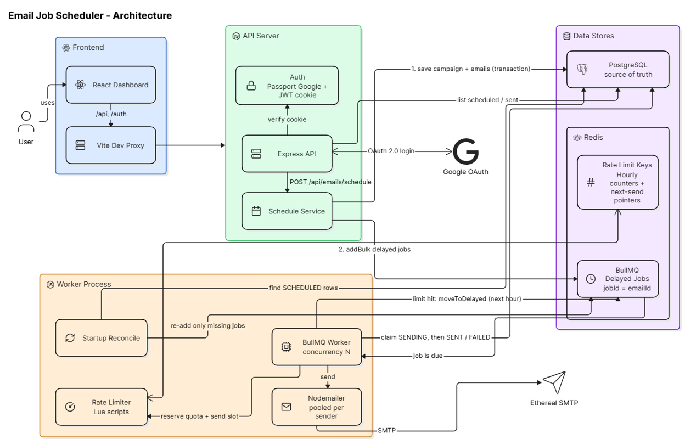
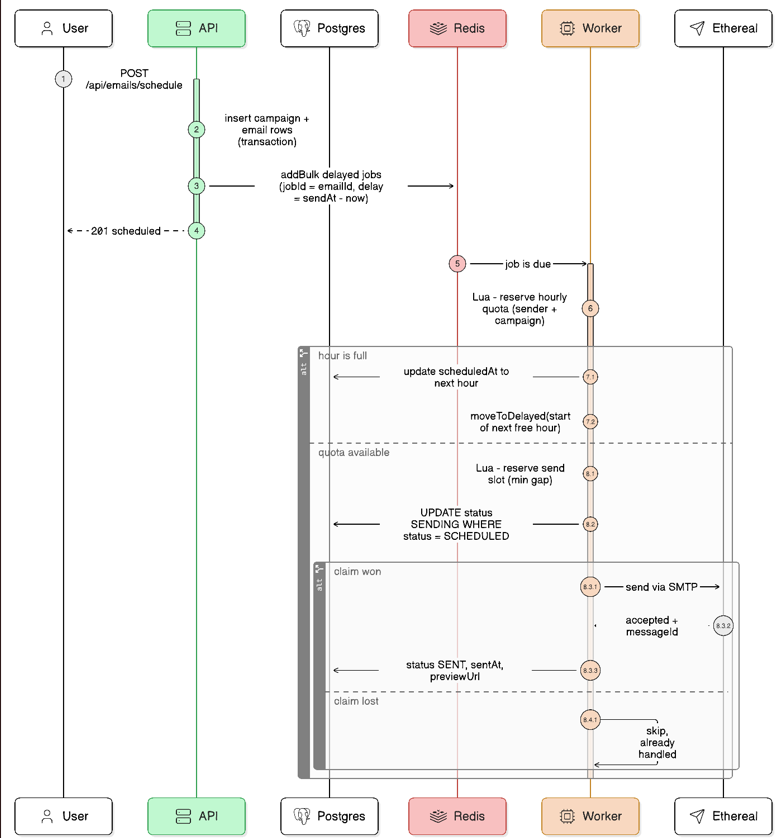

# Email Job Scheduler

Schedule cold emails to a list of leads and have them sent at the right time, at a controlled pace, even if the server restarts in between.

The backend accepts a batch of emails, stores them in Postgres and turns each one into a delayed BullMQ job. A worker sends them through Ethereal SMTP while respecting a minimum gap between sends and an hourly limit. The React dashboard lets you log in with Google, compose and schedule emails, and watch them move from Scheduled to Sent.

**Live:** https://outbox.ankitsingh.me

**Demo video:** _add link here_

**Stack:** TypeScript, Express 5, BullMQ + Redis, PostgreSQL (Prisma), Nodemailer/Ethereal · React 19, Vite, Tailwind CSS v4, TanStack Query · Docker Compose

---

## Running it locally

You need Node 20+ and Docker.

**1. Start Postgres and Redis**

```bash
docker compose up -d
```

Redis is started with AOF persistence turned on, so queued jobs survive a Redis restart too, not just an app restart.

**2. Set up the backend**

```bash
cd backend
cp .env.example .env
npm install
npx prisma migrate deploy
npm run senders:create
```

`senders:create` creates two Ethereal SMTP accounts and saves them as senders. Fill in `GOOGLE_CLIENT_ID`, `GOOGLE_CLIENT_SECRET` and `JWT_SECRET` in `.env` (see below).

**3. Run the API and the worker** (two terminals)

```bash
npm run dev          # API on http://localhost:4000
npm run dev:worker   # BullMQ worker
```

The worker is a separate process, so you can run several of them, on one machine or many, against the same Redis and Postgres.

**4. Run the frontend**

```bash
cd frontend
npm install
npm run dev          # http://localhost:5173
```

Vite proxies `/api` and `/auth` to the backend, so the browser sees a single origin and the auth cookie works without extra CORS setup.

### Google OAuth

1. In [Google Cloud Console](https://console.cloud.google.com/apis/credentials), set up the OAuth consent screen (External) and add your Google account as a test user.
2. Create an OAuth client ID of type **Web application**.
3. Add `http://localhost:4000/auth/google/callback` as an authorised redirect URI.
4. Copy the client ID and secret into `backend/.env`.

### Ethereal Email

There's nothing to sign up for. `npm run senders:create` asks Ethereal for throwaway SMTP accounts and prints their logins. Mail sent through them never reaches a real inbox. You can read it either by clicking **View on Ethereal** on a sent email in the dashboard, or by logging in at <https://ethereal.email>. Run `npm run senders:create -- 3` to add more senders.

### Environment variables

| Variable | Default | What it does |
|---|---|---|
| `DATABASE_URL` | – | Postgres connection string |
| `REDIS_URL` | `redis://localhost:6379` | BullMQ and rate-limit counters |
| `FRONTEND_URL` | `http://localhost:5173` | CORS origin and where to go after login |
| `GOOGLE_CLIENT_ID`, `GOOGLE_CLIENT_SECRET` | – | Google OAuth |
| `GOOGLE_CALLBACK_URL` | `http://localhost:4000/auth/google/callback` | Must match the Google console |
| `JWT_SECRET` | – | Signs the session cookie |
| `WORKER_CONCURRENCY` | `5` | Jobs one worker process runs in parallel |
| `MIN_DELAY_BETWEEN_SENDS_MS` | `2000` | Minimum gap between two sends from the same sender |
| `MAX_EMAILS_PER_HOUR_PER_SENDER` | `200` | Hourly cap per sender |
| `SEND_MAX_ATTEMPTS` | `3` | Retries for SMTP errors (exponential backoff starting at 5 s) |

The default delay is **at least 2 seconds between emails from the same sender**. A campaign can ask for a longer gap in the Compose screen; the longer of the two is used.

---

## How it works



The API and the worker are separate processes that never call each other directly. The API writes emails to Postgres and queues jobs in Redis. The worker picks up due jobs from Redis, checks the rate limits, sends through Ethereal, and records the result in Postgres.

### Scheduling

When you click Schedule, the API validates the request, removes duplicate addresses and saves one `Campaign` row plus one `Email` row per recipient in a single transaction. Each email gets a planned time of `startAt + position × delay`.

After the transaction commits, the API adds one BullMQ job per email with `addBulk`. Each job uses the email's id as its `jobId` and gets a `delay` equal to the time until it's due. BullMQ keeps the job in Redis and hands it to a worker when that time comes. There is no polling loop and no cron.

### Restarts

Jobs live in Redis, not in the Node process, so stopping and starting the API or the worker doesn't touch them. Redis itself writes to disk (AOF), so restarting the Redis container is also safe.

Postgres remains the source of truth. When a worker starts, it checks every email still marked `SCHEDULED` and re-adds a job only if Redis doesn't already have one. Because the job id is the email id, BullMQ ignores a job it already has, so this check can't create duplicates, even if several workers run it at the same time. It exists for two rare cases: Redis losing data, and the API crashing between saving the rows and queueing them.

On Ctrl+C the worker finishes the emails it's currently sending before it exits.

### No duplicate sends

Before sending, the worker claims the email with one conditional update:

```sql
UPDATE "Email" SET status = 'SENDING' WHERE id = $1 AND status = 'SCHEDULED'
```

Only the worker whose update actually changes the row is allowed to send. A plain "read the status, then send" check isn't enough, because two workers could both read `SCHEDULED` at the same moment.

The one case that can't be fully resolved is a crash after the SMTP server accepted the message but before the row was marked `SENT`. There's no way to know whether the email went out. Here the system picks **at-most-once**: when the stuck job is picked up again, the email is marked `FAILED` instead of being resent. For cold outreach, sending someone the same email twice is worse than missing one. Every message also gets a fixed `Message-ID` based on the email id, which would make a duplicate easy to spot.

Ordinary SMTP errors (connection refused, timeout) put the email back to `SCHEDULED`, and BullMQ retries it with backoff. After the last attempt it's marked `FAILED` with the error message.

The full path of a single email, including the rate-limit check and the claim:



### Rate limiting

All limiter state lives in Redis and is updated by small Lua scripts. Redis runs each script atomically, so the counts stay correct no matter how many workers are running. Nothing is counted in memory.

There are two separate checks.

**Hourly limit.** For every UTC clock hour there's a counter per sender and a counter per campaign. When a job comes due, a script looks at the current hour. If both the sender limit (`MAX_EMAILS_PER_HOUR_PER_SENDER`) and the campaign's hourly limit (set in Compose) have room, it increments both and the email can go. If either is full, the script moves on to the next hour that has room and claims a slot there. The worker then moves the job to the start of that hour with `job.moveToDelayed()` and throws BullMQ's `DelayedError`, which marks the job as rescheduled rather than completed or failed. The email's `scheduledAt` is updated, so the dashboard shows when it will really go out. Jobs are never dropped.

**Minimum gap.** Once a job is actually due, a second script hands out send times at least `gap` milliseconds apart, per sender and per campaign, using a "next free time" value stored in Redis. If the next free time is a few seconds away, the job waits until then.

The two checks used to be one. That turned out to be a mistake: when one campaign hit its hourly limit, the sender's "next free time" jumped to the next hour and blocked every other campaign on that sender, even though the sender had capacity left. Separating them fixed it, and other campaigns now keep sending while one waits for the next hour.

To keep order when a batch is pushed into a new hour, each job is released at `start of hour + its position in milliseconds`, so they wake up in the original order.

### Concurrency

`WORKER_CONCURRENCY` controls how many jobs one worker handles at a time, and you can start as many worker processes as you like. Running jobs in parallel is safe because:

- each email has exactly one job,
- sending requires winning the database claim,
- the limits are atomic Redis operations, and
- each sender's SMTP connection pool is shared by its jobs.

With concurrency above 1, emails that become due at the same moment may go out in a slightly different order within a few seconds. The gap and the hourly limit still always hold.

### 1000+ emails at the same time

The API saves rows in chunks of 1,000 and queues jobs in chunks of 500, so scheduling 1,000 emails takes about 300 ms locally. When they all become due, each job claims its hourly slot atomically. With an hourly limit of 20, the first 20 go in the current hour and the rest are spread across the following hours, 20 per hour, in order. Within each hour, sends are spaced by the minimum gap.

To try it (you need to have logged in once):

```bash
cd backend
npm run load-test -- 1000 20 0     # count, hourly limit, delay in seconds
```

---

## Trying the restart scenario

1. Schedule a few emails for 2–3 minutes from now.
2. Stop the API and the worker with Ctrl+C. Optionally run `docker restart scheduler-redis` too.
3. Start them again. The worker logs `queue already in sync with database`.
4. The emails go out at the original time, once each.

---

## API

All `/api` routes need the session cookie that Google login sets.

| Method | Path | |
|---|---|---|
| GET | `/auth/google` | Start Google login |
| GET | `/auth/google/callback` | OAuth callback, sets the cookie, redirects to the app |
| GET | `/auth/me` | Logged-in user |
| POST | `/auth/logout` | Clear the cookie |
| GET | `/api/senders` | Sender accounts |
| POST | `/api/emails/schedule` | Schedule a batch |
| GET | `/api/emails/scheduled` | Scheduled and sending emails (`search`, `status`, `page`, `pageSize`) |
| GET | `/api/emails/sent` | Sent and failed emails (same parameters) |
| GET | `/api/emails/counts` | Counts for the sidebar |
| GET | `/api/emails/:id` | One email with its body and Ethereal link |
| GET | `/health` | Checks Redis and Postgres |

Example `POST /api/emails/schedule` body:

```json
{
  "senderId": "6b1f…",
  "subject": "Quick question",
  "body": "<p>Hi there…</p>",
  "recipients": ["a@example.com", "b@example.com"],
  "startAt": "2026-10-25T10:00:00.000Z",
  "delaySeconds": 5,
  "hourlyLimit": 50
}
```

---

## Features

**Backend**

- Scheduling API with validation, saved to Postgres: `api/emails.routes.ts`, `services/schedule.service.ts`
- BullMQ delayed jobs, no cron: `queue/emailQueue.ts`
- Multiple senders on Ethereal SMTP: `scripts/createSenders.ts`, `mail/mailer.ts`
- Persistence across restarts (Redis AOF plus a startup check against the DB): `queue/reconcile.ts`
- No duplicate sends (job id = email id, atomic claim): `queue/emailProcessor.ts`
- Configurable worker concurrency: `worker.ts`
- Minimum gap between sends, and hourly limits per sender and per campaign, stored in Redis: `rateLimiter/sendSlots.ts`
- Emails over the limit are moved to the next hour, never dropped
- Retries with backoff for SMTP errors
- Load-test script for 1000+ emails: `scripts/loadTest.ts`

**Frontend**

- Google login with name, email and avatar in the header, plus logout: `pages/LoginPage.tsx`, `components/layout/UserMenu.tsx`
- Dashboard with Scheduled and Sent tabs, counts and a Compose button: `components/layout/Sidebar.tsx`, `pages/MailboxPage.tsx`
- Compose with sender, recipients, subject, rich-text body, delay and hourly limit: `pages/ComposePage.tsx`
- CSV/TXT lead upload that reports how many valid addresses it found and what it skipped: `lib/parseLeads.ts`
- "Send Later" picker with quick options: `components/compose/SendLaterPopover.tsx`
- Email lists with time and status, loading skeletons, empty states, error states with retry
- Search, status filter, refresh, "Load more", and a refresh every 5 seconds so you can watch emails get sent
- Email detail page with a link to the message on Ethereal
- Reusable UI pieces (`components/ui`) and typed API responses (`types/api.ts`, `lib/api.ts`)

---

## Assumptions and trade-offs

- **At-most-once delivery.** An email whose send was interrupted is marked failed instead of retried, so a recipient never gets it twice.
- **Hourly windows are UTC clock hours.** In India (UTC+5:30) the next window therefore starts at :30 past the hour. A rolling 60-minute window would need more bookkeeping per sender; fixed hours are simpler and easy to reason about.
- **A slot counts as used when it's reserved, not when the email is sent.** A failed attempt that's retried counts again. Counting too many is the safe side for a rate limit.
- **Order is best-effort** with concurrency above 1. Strict per-sender ordering would need concurrency 1 per sender.
- **Login uses a signed JWT in an httpOnly cookie** instead of server-side sessions. It's stateless and works across multiple API instances, but a token can't be revoked before it expires (7 days).
- **SMTP passwords are stored in plain text** in Postgres. Fine for Ethereal test accounts; real credentials would need encryption.
- **The Lua scripts assume a single Redis.** Redis Cluster would need the keys to share a hash tag.
- **Email/password login** appears because it's in the Figma, but only Google login is implemented, as the brief requires.
- **Attachments, star, archive and delete** are in the Figma but not in the brief, so they're left out.
- **Every user can send from every sender.** Per-user senders would be the next step.
- **`cron-parser` shows up in `package-lock.json`** as a dependency of BullMQ, for its repeatable-jobs feature. This project doesn't use repeatable jobs or cron.

---

## Deployment

The live version runs on a single AWS EC2 instance (t3.small, Amazon Linux 2023) with Docker Compose. `docker-compose.prod.yml` starts:

- **postgres** and **redis** (AOF on), not exposed outside the Docker network
- **migrate**, which runs `prisma migrate deploy` once and exits
- **api** and **worker**, two containers from the same backend image
- **web**: Caddy serving the React build and proxying `/api` and `/auth` to the API, with automatic HTTPS from Let's Encrypt

Only ports 80 and 443 are open. The instance has an Elastic IP, and the domain points to it with an A record.

To deploy on a fresh Amazon Linux 2023 host:

```bash
bash deploy/setup-server.sh                       # Docker, Compose, Buildx, swap
cp deploy/.env.production.example .env.production # fill in domain, secrets, Google OAuth
docker compose -f docker-compose.prod.yml --env-file .env.production up -d --build
docker compose -f docker-compose.prod.yml --env-file .env.production run --rm migrate npm run senders:create
```

For Google login, add `https://<domain>` as an authorised JavaScript origin and `https://<domain>/auth/google/callback` as a redirect URI.

---

## Project layout

```
docker-compose.yml        Postgres + Redis for local development
docker-compose.prod.yml   full production stack
deploy/                   Caddyfile, server setup script, env template
backend/
  prisma/schema.prisma    User, Sender, Campaign, Email
  scripts/                createSenders, loadTest
  src/
    index.ts              API entry point
    worker.ts             worker entry point
    api/                  routes and error handling
    auth/                 Google strategy, JWT cookie, auth middleware
    queue/                queue, job processor, startup check
    rateLimiter/          Redis Lua scripts
    mail/                 SMTP transports
    services/             scheduling and queries
frontend/
  src/
    components/ui/        buttons, popover, avatar, spinner, empty state
    components/layout/    sidebar, user menu, page header
    components/emails/    list, row, status badge, toolbar
    components/compose/   recipients, send-later picker, editor
    pages/                Login, Mailbox, Compose, EmailDetail
    hooks/, lib/, types/
```
